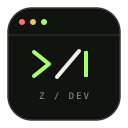

<!-- Mohammed Zeeshan | GitHub Profile README -->

# Mohammed Zeeshan

**AI/ML Engineering Student · Developer · Security Enthusiast**

Building things, breaking things, figuring out how they work.

[LinkedIn](https://www.linkedin.com/in/zeeshannmohammed) · [X](https://x.com/Zeeshannog) · [GitHub](https://github.com/Veracious-commits)

---

### `$ whoami`

I'm Zeeshan, a B.E. Artificial Intelligence & Machine Learning student graduating in 2027.

I work across Python, AI, web development, and cybersecurity. I like projects that solve actual problems, especially where software meets everyday life.

Currently working on **Scam Shield** — a multilingual scam detection project focused on suspicious messages and payment requests.

`Bengaluru, India` · `Open to internships`

### `$ ls ./projects`

<table>
<tr>
<td width="100%">

#### 01 / Speech → Text → Image

A Flask application that turns spoken words or text prompts into AI-generated images, with support for two image-generation backends.

`Python` `Flask` `APIs` `HTML/CSS`

[↗ Explore the repository](https://github.com/Veracious-commits/Speech-text-image-generation-)

</td>
</tr>
<tr>
<td width="100%">

#### 02 / Scam Shield

**Status: In progress**

An idea in development to detect potential scams across SMS, WhatsApp messages, and UPI-related payment requests using machine learning and NLP.

`Python` `NLP` `Machine Learning` `Security`

*Repository coming soon.*

</td>
</tr>
</table>

### `$ cat toolbox.txt`

**Languages**

Python · C++ · Java · JavaScript · HTML · CSS

**Tools & technologies**

Flask · TensorFlow · Git · Arduino

### `$ uptime`

Currently learning by building, experimenting, and improving one project at a time.

If you're working on something interesting in AI/ML, full-stack development, or cybersecurity, let's connect.

Built with curiosity, not a template.

